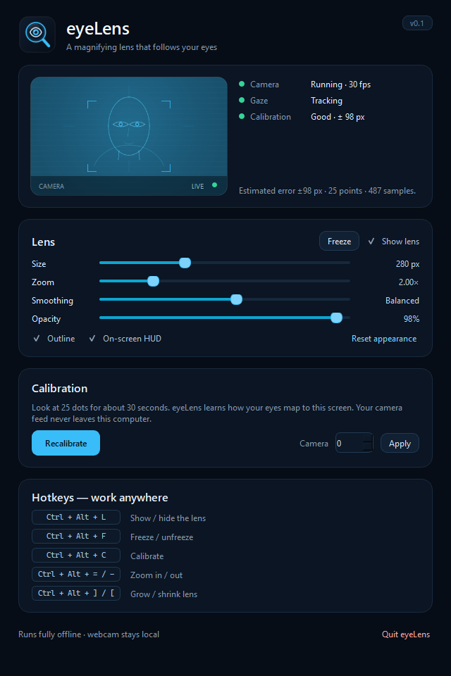
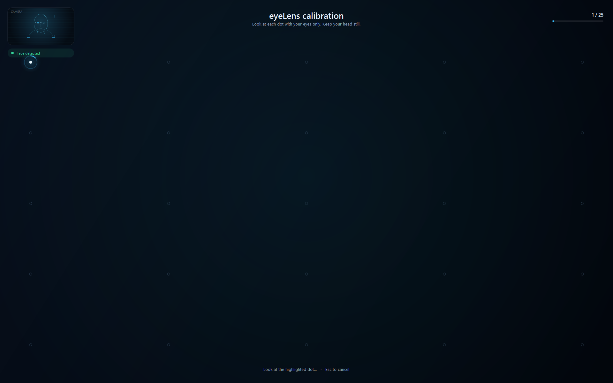

# eyeLens

**A click-through magnifying lens that follows your eyes.**

eyeLens uses an ordinary webcam to estimate where you are looking on screen, then
draws a circular, always-on-top magnifier over that spot. The lens can be any
size from 120 to 1200 px high (wide lenses are 1.6× wider) and zoom from 1×
to 6×. A short guided calibration
teaches it how *your* eyes map to *your* screen.



## Why

Sometimes you need a closer look without changing the zoom of the app you are
using, moving a mouse, or interrupting what you are doing. eyeLens magnifies the
area you are already looking at. Freeze the lens with one hotkey when you want
to read, then unfreeze it and continue working.

## Features

- **Webcam eye tracking** — no special hardware, no IR tracker, no cloud.
- **Guided 25-point calibration + 9-point accuracy check** — about 50 seconds,
  saveable and reusable. The result screen shows the error measured on the
  independent check points.
- **Zoomed eye preview** — calibration shows a large close-up of both eyes plus
  a small whole-face inset, so positioning and iris tracking are easy to check.
- **Head-pose compensation** — MediaPipe’s 6-DOF face transform is used for an
  optional global correction. When enabled, moving your head recalculates the
  mapping so the lens keeps following the same screen point.
- **Variable lens** — 120–1200 px high, round / square / wide (1.6× wider),
  1×–6× magnification, adjustable opacity.
- **Big lens on demand** — press `Ctrl+Alt+B` for a screen-sized lens; press
  again to return to your previous size.
- **Smooth and stable** — adaptive 1€ filtering, blink rejection, and a short
  hold when tracking is temporarily lost.
- **Freeze mode** — lock the lens in place for comfortable reading.
- **Mouse correction** — if the lens sits off target, press `Ctrl+Alt+D`,
  drag the small handle to where you are looking, and release. The model
  learns that local correction immediately.
- **Truly click-through** — the overlay uses `WS_EX_TRANSPARENT`; clicks, scrolls,
  and keyboard input go to the app underneath.
- **No self-reflection** — the lens is excluded from its own screen capture
  (`WDA_EXCLUDEFROMCAPTURE`), so it never films itself.
- **Tray + global hotkeys** — control everything while another app has focus.
- **Offline and private** — video frames are processed in memory and never saved
  or uploaded. Calibration is stored locally.

## Requirements

- Windows 10 (2004 or newer) or Windows 11
- Python 3.10–3.12 (3.12 recommended)
- A webcam and reasonably even lighting
- One primary display (multi-monitor support is on the roadmap)

## Quick start

```bat
git clone https://github.com/Closegamer/eyeLens.git
cd eyeLens
run.bat
```

`run.bat` creates a Python 3.12 virtual environment, installs the dependencies,
and launches eyeLens.

Manual setup:

```powershell
py -3.12 -m venv .venv
.\.venv\Scripts\python.exe -m pip install -r requirements.txt
.\.venv\Scripts\python.exe -m eyelens
```

Try the lens without a camera first:

```powershell
.\.venv\Scripts\python.exe -m eyelens --demo
```

In demo mode the lens follows the mouse pointer instead of your eyes.

## First calibration

1. Launch eyeLens and sit comfortably in front of the webcam.
2. Click **Calibrate now**. Keep your face fully visible and avoid backlighting.
   The large **EYES** panel is a zoomed view of both eyes; the small **FACE**
   inset shows the whole camera frame so you can check your framing.
3. Look at each of the 25 dots **with your eyes only** while keeping your head
   still. If the header says **“Head moved”**, return to your starting head
   position; samples for that dot pause until you do. The dot turns into a
   progress ring while samples are collected.
4. After the 25th dot, eyeLens repeats a short 9-dot **accuracy check** on
   points it did not train on. This measures the real error instead of guessing.
5. When the result appears, press **Enter** to keep the calibration or **R** to
   try again. The checked error is shown in pixels. If a head-pose correction
   improves the held-out check, the result also says **head pose**; that is the
   layer that recalculates the mapping when your head moves.
6. The lens appears and starts following your gaze.

Calibration is personal and tied to the current screen geometry. Recalibrate if
you move the camera, change the display resolution or scaling, or notice the
lens drifting everywhere.

If the lens is accurate overall but slightly off in specific spots, you do not
need to recalibrate: press `Ctrl+Alt+D`, drag the lens to where you are looking,
and release. Repeat for other regions. Corrections are saved with the
calibration.



## Controls

| Shortcut | Action |
| --- | --- |
| `Ctrl + Alt + L` | Show / hide the lens |
| `Ctrl + Alt + F` | Freeze / unfreeze the lens position |
| `Ctrl + Alt + C` | Start calibration |
| `Ctrl + Alt + D` | Correct / drag the lens position |
| `Ctrl + Alt + B` | Big lens on / off |
| `Ctrl + Alt + =` / `Ctrl + Alt + -` | Zoom in / out |
| `Ctrl + Alt + ]` / `Ctrl + Alt + [` | Grow / shrink the lens |

Everything is also available from the tray icon and the settings window:

- **Shape** — round, square, or wide. The size slider sets the height; a wide
  lens is 1.6× wider.
- **Size** — lens height in logical pixels, up to 1200.
- **Big lens** — toggle a large screen-sized lens without moving the slider
  (`Ctrl+Alt+B`).
- **Zoom** — true magnification of the area under the lens (2× shows an area
  half the lens dimensions, scaled up).
- **Smoothing** — higher is calmer and slower; lower is faster but jitterier.
- **Opacity** — how strongly the lens covers the content underneath.
- **Outline / On-screen HUD** — visual chrome and the small zoom/size badge.
- **Freeze** — keeps the lens where it is while your eyes move.
- **Fix position** — turns the lens into a draggable handle; drop it where you
  are looking and the model learns that correction. Also `Ctrl+Alt+D`.
- **Camera** — choose a different webcam index and apply it. Changing the camera
  usually requires recalibrating for best accuracy.

## How it works

```
webcam ──► MediaPipe Face Landmarker (478 landmarks, both irises)
       ──► 14 features in a roll-corrected eye frame
            iris position in each eye, vergence, plus head/face diagnostics
       ──► fitted model uses the 8 eye-in-head features
            (raw head/face drift made held-out accuracy much worse)
       ──► optional global head-pose correction from MediaPipe's 6-DOF face
            transform; enabled only if it improves the 9 held-out points
       ──► per-user hybrid model (eye-term polynomial + kernel-ridge residual)
            trained on 25 screen targets with grouped leave-one-point-out
            cross-validation; a separate 9-point check measures real error
       ──► 1€ filter + blink/loss handling
       ──► lens position (screen logical pixels)
       ──► padded 30 fps screen capture around the lens
       ──► always-on-top click-through Qt overlay
```

A few implementation details that matter:

- The fitted model uses only the 8 eye-in-head features. Raw head/face
  translation features are kept for diagnostics and for the live “head moved”
  calibration warning; using them as predictors made held-out accuracy much
  worse on real calibration data.
- Head pose (face forward vector + translation) is collected with every sample.
  A strongly regularised global correction is fitted on the primary residuals
  and enabled only if it improves the 9 held-out points by at least 3% and
  5 px. This is the layer that recalculates the mapping when your head moves.
- Calibration shuffles the dot order and watches the head pose. If you drift
  from the starting position, it warns and stops collecting samples for that
  point, then retries it.
- Eye measurements are made in a rotated eye frame, so a tilted head does not
  fake vertical gaze or a blink.
- Calibration keeps every stable frame from each target (usually several hundred
  samples) and discards blink/outlier frames per target before fitting.
- During calibration the camera preview crops a fixed-aspect region around both
  eyes and upscales it, so the iris/eyelid landmarks are easy to see; a small
  whole-face inset keeps framing visible.
- The polynomial stage captures the global gaze trend; a kernel-ridge residual
  stage captures the local nonlinearity the polynomial misses. The kernel stage
  is only enabled when grouped cross-validation says it helps.
- The 9 accuracy-check points are never used to fit the primary model, so the
  error shown on the result screen is a real held-out measurement.
- Mouse corrections are a local residual memory on top of the fitted model:
  each drag stores the difference between the drop point and the model's
  prediction at the current gaze features. Nearby corrections blend with an RBF
  weight, so a fix applies where you made it and decays elsewhere. No full
  recalibration is needed.
- Runtime predictions are clipped to the calibrated feature range, and the
  kernel residual is bounded, preventing a bad frame from throwing the lens
  across the screen.
- `SetWindowDisplayAffinity(WDA_EXCLUDEFROMCAPTURE)` hides the overlay from
  `mss`; otherwise a magnifier would show an infinite mirror of itself.
- Screen capture grabs only a padded square around the lens, not the whole
  desktop, which keeps CPU use low even at high zoom.

## Privacy

- Video frames live only in memory. Nothing is recorded, written to disk, or sent
  anywhere.
- The webcam LED stays on while eyeLens is running because the camera is open.
  Quit eyeLens from the tray to release the camera.
- Settings and calibration are stored under `%LOCALAPPDATA%\eyeLens\`:
  `settings.json` and `calibration.json`.
- The face-landmarker model is bundled in `models/`. If it is missing, eyeLens
  downloads it once from Google's MediaPipe model storage; no other network
  access is performed.

## Troubleshooting

**The camera cannot be opened.**
Check Windows *Settings → Privacy & security → Camera*, close other apps that use
the webcam, then try another camera index in the settings window.

**Calibration never starts.**
Your face must be visible in the preview. Improve lighting, remove backlight,
move closer to the camera, and make sure the correct camera is selected.

**The EYES preview is black or not zoomed.**
The zoomed view needs a detected face. Use the small FACE inset to centre your
face, improve the lighting, and wait for the status pill to turn green.

**The lens drifts or jumps.**
Recalibrate. Keep your head still during calibration and look at the centre of
each dot. Increase **Smoothing** if the lens jitters or moves too quickly;
decrease it if it feels sluggish.

**The lens is still slightly off in one area.**
Press `Ctrl+Alt+D`, drag the small handle to where you are actually looking,
and release. eyeLens stores a local correction and keeps it. Repeat in other
screen regions if needed. Recalibrate to discard all corrections and start over.

**The lens drifts when I move my head.**
Recalibrate. Calibration records your head pose at every dot and adds a global
head-pose correction if it improves the 9 held-out points by at least 3% and
5 px. When that correction is active, the status shows **head pose**. If it is
not shown, the eye-only mapping was more accurate for your data.

**The lens shows a mirror image of itself.**
This should not happen on Windows 10 2004+ / Windows 11. If you see a warning in
the console about `SetWindowDisplayAffinity`, your Windows build or graphics
driver does not support capture exclusion. Update Windows and your GPU driver.

**The image under the lens is dark near screen edges.**
The lens is clamped to stay fully visible, so at screen edges part of the
magnified area is off-screen. This is expected.

**A hotkey conflicts with another app.**
Edit `eyelens/hotkeys.py` and change the `HOTKEYS` mapping. Display-rotation
shortcuts such as `Ctrl+Alt+Arrow` are intentionally not used.

**Reset everything.**

```powershell
.\.venv\Scripts\python.exe -m eyelens --reset-calibration
```

or delete `%LOCALAPPDATA%\eyeLens\calibration.json` and
`%LOCALAPPDATA%\eyeLens\settings.json`.

## CLI

```text
python -m eyelens [options]

--demo                 Follow the mouse; no camera or calibration needed.
--camera N             Webcam index for this run.
--settings             Open the settings window even when calibrated.
--reset-calibration    Delete the saved calibration.
--model PATH           Use a specific face_landmarker.task file.
--version              Print the version.
```

Useful developer command:

```powershell
python -m eyelens --smoke-test
```

It starts in demo mode and exits after a few seconds, which is handy for
verifying a checkout.

## Development

```
eyelens/
├── app.py                    controller, tray, hotkeys, startup
├── capture.py                padded screen capture thread
├── config.py                 paths, settings, model bootstrap
├── hotkeys.py                global hotkeys (pynput)
├── gaze/
│   ├── features.py           MediaPipe landmarks -> 14 features
│   ├── model.py              calibration: ridge + kernel-ridge residual
│   ├── filters.py            1€ filter
│   ├── tracker.py            camera + MediaPipe thread
│   └── engine.py             prediction + smoothing + demo mode
└── ui/
    ├── overlay.py            click-through always-on-top lens
    ├── calibration_window.py full-screen calibration flow
    ├── correction_handle.py small draggable mouse-correction handle
    ├── settings_window.py    settings, status, camera preview
    └── icon.py               programmatic app icon
```

Run the tests:

```powershell
.\.venv\Scripts\python.exe -m pip install -r requirements-dev.txt
.\.venv\Scripts\python.exe -m pytest
```

The unit tests cover feature extraction, calibration maths, filtering, and
settings. A live end-to-end calibration needs a webcam and a person looking at
the screen, so it is intentionally not automated; the two-stage calibration
state machine is exercised with a fake tracker during development.

## Limitations / roadmap

- Windows only for now because the no-feedback capture exclusion is
  Windows-specific.
- Primary display only; the calibration and overlay target the primary screen.
- One face at a time.
- Webcam gaze estimation is approximate. Typical setups land in the
  ±80–200 px range after calibration; lighting and camera quality matter more
  than raw resolution.
- The lens is circular. Rectangular/elliptical shapes, per-app profiles, and
  dwell-to-freeze are natural next steps.

## License

eyeLens is released under the MIT License. See [LICENSE](LICENSE).

The bundled MediaPipe Face Landmarker model is distributed under the Apache
License 2.0; see [models/README.md](models/README.md).
